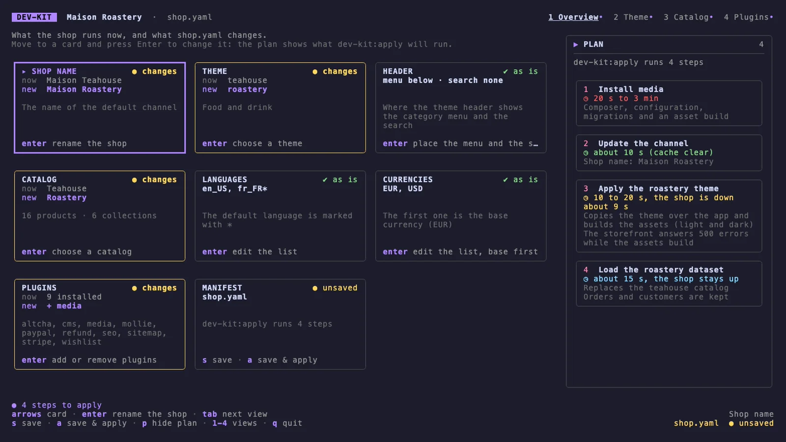
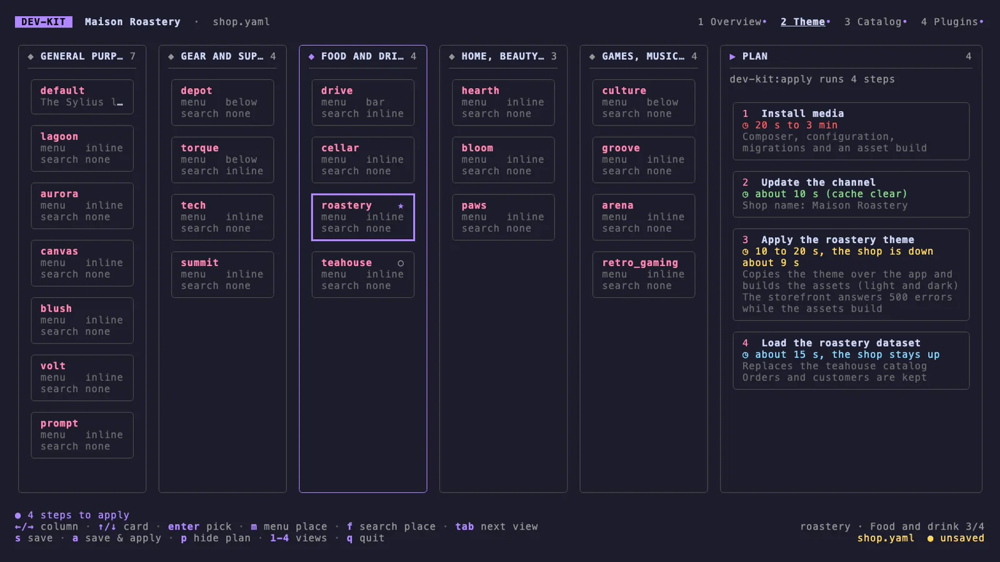
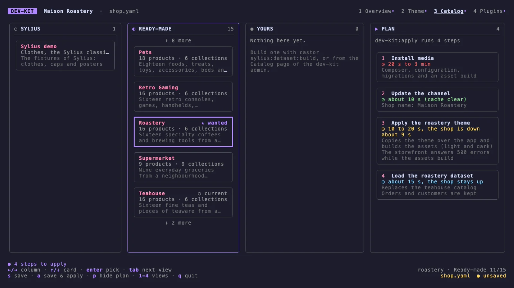
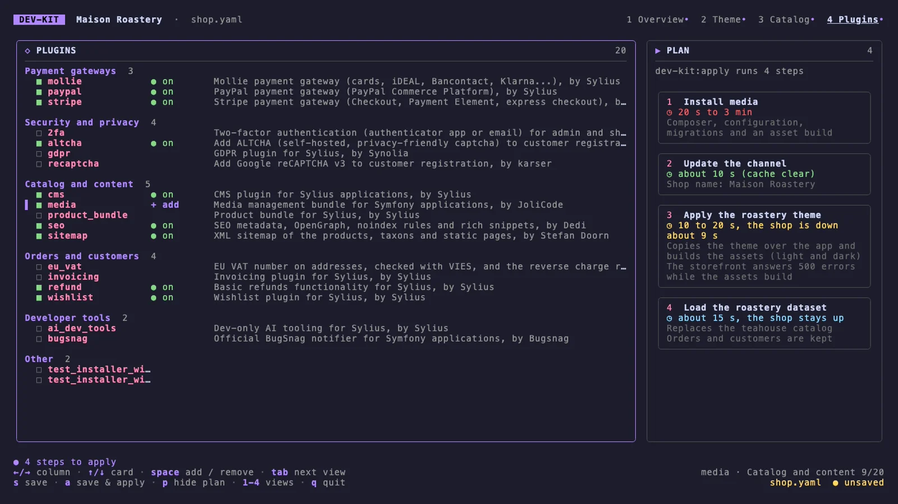

The dev-kit builds your local shop little by little. `starter.yaml` holds the shop you want: its catalog, theme and
header, name, locales, currencies and plugins. `castor dev-kit:apply` compares it with the running instance and
changes only what differs, showing what each step costs before it runs. The shop runs from the start: change one
setting, apply, look at the result, go on.

| Package                              | What it brings                                                                 |
|--------------------------------------|--------------------------------------------------------------------------------|
| `opencolibri/starter-dev-kit`        | `dev-kit:status`, `dev-kit:init`, `dev-kit:apply`, `dev-kit:tui`, `dev-kit:channel`, `dev-kit:history`, `dev-kit:catalog` |
| `opencolibri/starter-dev-kit-bundle` | The admin: one card per setting, each showing its plan before it runs (Sylius Shadcn Admin UI) |

## The admin

`opencolibri/starter-dev-kit-bundle` is a Symfony bundle, duplicated from the [sales kit](../sales-kit/index.md) admin
but for one shop, the one you build. Its dashboard sums up what the shop runs now, and one page per topic holds the
cards: **Storefront** (the theme, picked on its thumbnails grouped and filtered by the categories of the
[theme list](../themes/index.md), and in the sidebar the header layout of the picked theme, on a wireframe of the
header: both apply together), **Catalog** (open a dataset to see its products by collection, then load it, or [make your own](#your-own-dataset)), **Locales and currencies**, **Plugins** (grouped and filtered by category, searched as you type, what to install and remove listed in the sidebar) and **Shop** (its name). A package
or an instance adds its own pages (`opencolibri_dev_kit.pages`, see the README of the bundle). Change a card: the plan of `dev-kit:apply` shows up with the cost of each step, and
**Apply** runs it. The run is followed in the tasks panel, step by step, and the page reloads once it finishes. The
history lists every state an apply brought the shop to, and plans the way back to any of them.

`castor dev-kit:init` installs it (`--no-admin` to skip it): a small Symfony app (AssetMapper, Tailwind) in the
`dev-kit/` directory of the project, run as a Symfony service of the stack next to the Sylius one
(`castor docker:service:install dev-kit` does the same alone). It has no login: it only drives your local shop. The
admin calls the `dev-kit:*` tasks through [castor-api](https://github.com/jeromegxj/castor-api), which the project
imports (`castor.php`) and runs on the host:

```bash
castor up                          # the Sylius stack and the dev-kit admin (https://dev-kit.<shop domain>/)
castor api:serve-development       # castor-api, on http://127.0.0.1:8080
```

The admin is served on `dev-kit.<shop domain>`: a `*.localhost` domain resolves by itself, another one (`.test`…)
needs its line in `/etc/hosts`, like the shop. It reaches castor-api through `host.docker.internal`, which Docker
Desktop maps to the host; on Linux, castor-api must listen where the container can reach it. `dev-kit/.env.local`
holds its settings (secret, URLs of castor-api, of the admin and of the storefront), and `castor dev-kit:composer`,
`castor dev-kit:symfony`… run its commands. It reads the progress of `dev-kit:apply` and the datasets from
`.castor/import/` of the project, which its container mounts. Once the shop is launched, remove the service from
`castor.php` and the `dev-kit/` directory.

### Your own dataset

The **Catalog** page searches the datasets as you type, and its **New dataset** menu makes one of your own:

- **Create with AI**: the AI writes a catalog from a description, then generates its images;
- **Import a website**: the catalog of a website you own is fetched, curated by the AI, and its images downloaded
  (see the [caution about scraping](../datasets/build.md#from-an-existing-website));
- **Write one by hand**, without AI: an empty dataset (name, description, suggested theme), then its collections (a two-level
  menu at most) and its products, each with its image (converted to WebP), price and description;
- **Import a zip**, without AI: a dataset downloaded from a sales kit or exported with `castor sylius:dataset:export`, or written
  in the [same layout](../datasets/index.md#the-format).

Uncheck **Generate the images** (or **Download the images**) to add them by hand from the product form, or to store
them later with **Generate the missing images** (or **Download**) on the page of the dataset. The AI builds take a few minutes: they run in the tasks panel, and the page shows the new dataset once they finish.
They need the AI settings of the project ([Configure the AI](../datasets/build.md#configure-the-ai)). The page of a
dataset built in the project, whatever way, edits it: its name, description and theme, its collections, its products
(click one to change it), its deletion. Once it is loaded, **Load it again** brings its changes into the shop
(`dev-kit:apply` only compares the slug of the dataset). The ready-made datasets are read only: import their zip under
another name to change a copy. The admin hands the images and zips over to the
[dataset tasks](../datasets/build.md#by-hand) through `.castor/import/var/.uploads/`: they come with
`opencolibri/starter-dataset-builder`, which the project needs for these pages (this repository has it).

## Get started

```bash
castor dev-kit:init              # write starter.yaml from what the shop runs now
castor dev-kit:apply --dry-run   # edit starter.yaml, then show the plan
castor dev-kit:apply             # run it
```

```yaml
shop:
  name: 'Maison Roastery'
dataset: roastery            # a dataset of `castor sylius:dataset:list`, or "sylius" for the Sylius demo data
theme:
  name: roastery             # a theme of `castor sylius:theme:setup`, or "default" for the Sylius look
  header:
    menu: below              # inline, below or bar
    search: icon             # none, inline, below or icon
locales:
  default: fr_FR
  enabled: [fr_FR, en_US]
currencies: [EUR, USD]       # the base currency first
plugins: [refund, altcha]    # the plugins of `castor sylius:plugin:add`
```

Leave a setting out to leave it as it is: the dev-kit manages only what the manifest lists. An empty `plugins: []`
does manage the plugins, and removes them all.

## In the terminal

`castor dev-kit:tui` edits `starter.yaml` without the admin: no service, no castor-api. It takes the whole terminal:



- **1 Overview**: a card per setting, with what the shop runs now and, when the manifest changes it, the new value.
  **Enter** on a card changes it: the name, the languages and the currencies are edited in place (**d** picks the
  default language), the other cards open their view.
- **2 Theme**: the themes as cards, a column per category. **Enter** picks one (its header placements follow), **m**
  and **f** change where its header shows the menu and the search.
- **3 Catalog**: the Sylius demo data, the ready-made datasets and yours. **Enter** picks one.
- **4 Plugins**: the plugins by category. **Space** adds or removes one.

| Themes | Catalogs | Plugins |
|---|---|---|
|  |  |  |

Next to the view, the plan of `dev-kit:apply` follows every change, with the cost of each step (**p** hides it; on a
narrow terminal, it is the **5 Plan** view). **s** saves the manifest, **a** saves it and runs `dev-kit:apply` (press
it twice when a step deletes data), **q** quits (twice with unsaved changes). A setting shown as `—` is not managed.

`--snapshot=<file.html>` writes the screen as HTML instead (`--size=160x44`, `--keys=2,down,enter` to press keys
first), to check the layout without a terminal.

It is a prototype built on [symfony/tui](https://symfony.com/doc/current/tui.html), which Castor bundles: the component
is experimental, so it may change with the next Castor version. It leaves out what the admin does with pictures
(theme thumbnails, dataset previews) and the dataset editor.

## What each change costs

Measured on the local Docker stack:

| Change                  | Runs                                     | Takes                                    |
|-------------------------|------------------------------------------|------------------------------------------|
| Header layout           | `sylius:theme:header`                    | about 10 s: hook configuration and a cache clear, no asset build |
| Name, locales, currencies | `dev-kit:channel`                      | about 10 s                               |
| Dataset                 | `sylius:dataset:load`                    | about 15 s, the shop stays up            |
| Theme                   | `sylius:theme:setup`                     | 10 to 20 s, the storefront answers 500 errors for about 9 s while the assets build |
| Plugins                 | `sylius:plugin:add`, `sylius:plugin:remove` | 20 s to 3 min: Composer, configuration, migrations, assets |

Pick a theme on its screenshots ([Themes](../themes/index.md)) before applying it. The steps run in this order:
plugins (removals first), channel, theme, dataset. The dev-kit stops at the first failure: run `dev-kit:apply` again
once fixed, it picks up where it stopped.

Removing a plugin rolls back its migrations, and the Sylius demo data (`dataset: sylius`) purge the database: the
dev-kit asks before these steps, or runs them with `--yes`. Plugins without a remover (`media`, `product_bundle`,
`refund`) cannot be removed by the dev-kit.

## What the dev-kit reads

`castor dev-kit:status` (`--format=json`) reads the instance itself: the theme and its header from the theme hooks,
the name, locales and currencies of the default channel (`WEB_STORE`) from the database. What Sylius does not store, the
dev-kit records in `var/dev-kit/state.json` of the app:

- the loaded dataset, once the dev-kit loads one;
- a theme setup that stopped halfway (its hooks are written before its assets build): the theme reads as unknown, and
  the next apply sets it up again;
- the installed plugins, once the dev-kit changes them. Before that, they are detected from `composer.json`, through
  the Composer package each installer declares ([`package`](../commands/custom-plugins.md), your own plugins too). From
  then on, the record wins: a plugin whose install stopped halfway is in `composer.json`, yet not installed, and the
  next `dev-kit:apply` installs it again.

## Limits

- The datasets are translated into `en_US` and `fr_FR` only: in another locale, the shop shows no product yet. The
  plan warns about it.
- A currency added without an exchange rate shows the prices of the base currency, unconverted. Add the rates in the
  Sylius admin.
- The channel is read and changed by `sylius:dev-kit:channel`, a console command the dev-kit copies into the app
  (`src/Command/DevKitChannelCommand.php`, refreshed before each use: do not change it). It goes through the Sylius
  repositories, so it works on MySQL as well as PostgreSQL.
