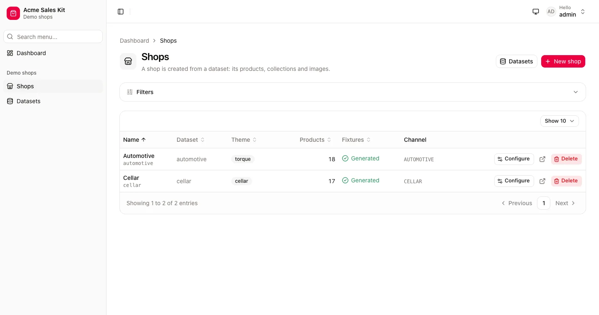
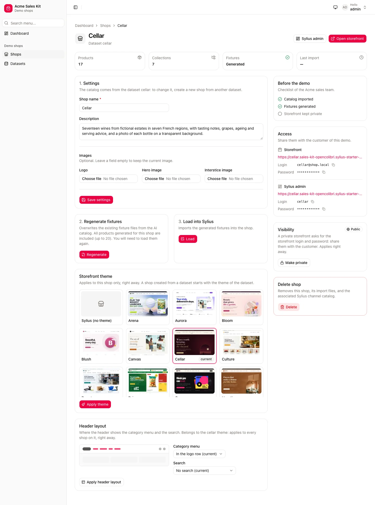
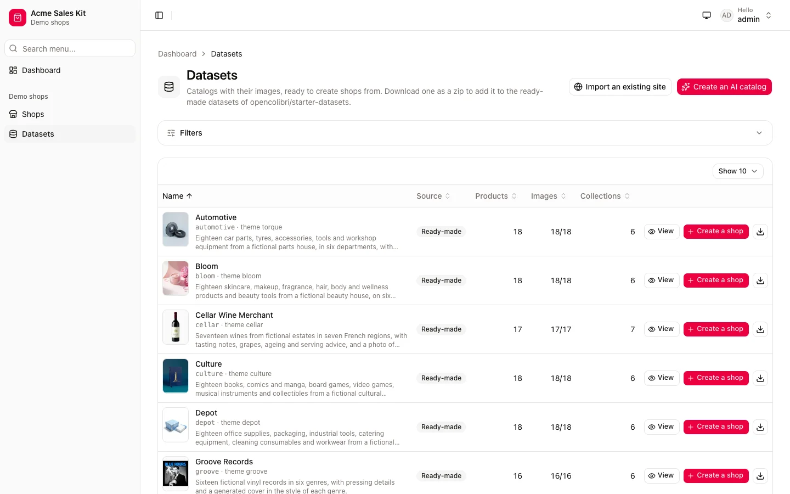
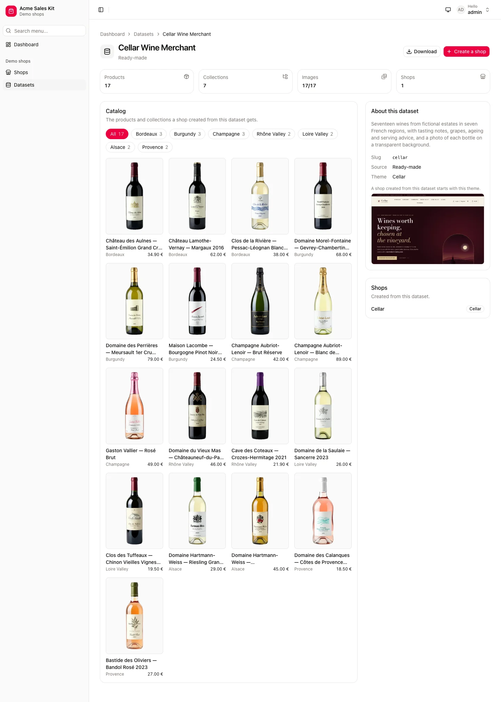

A sales kit runs many demo shops in one Sylius app, one channel and subdomain each, built from the
[datasets](datasets.md), an [AI catalog](ai-catalog.md) or an [existing website](existing-website.md). A sales team
creates a shop for a prospect in a few clicks, gives it the theme that suits them, and shares its storefront and its
own Sylius admin.



## The pieces

```
sales kit admin ──HTTP──▶ castor-api ──▶ Castor tasks ──▶ shared Sylius app (one channel per shop)
(opencolibri/starter-sales-kit)          (opencolibri/starter-import, opencolibri/starter-themes)
```

- **The stack** runs the shared Sylius app and [castor-api](https://github.com/jeromegxj/castor-api), which runs the
  Castor tasks over HTTP. Its `castor.php` enables the [import extensions](extending.md#extensions-shipped-with-the-import)
  the demo shops need (one theme per shop, private shops, one admin per shop) and installs every theme next to each
  other (`castor sylius:theme:setup all --target=theme-bundle`).
- **The admin**, `opencolibri/starter-sales-kit`, is a Symfony bundle built on Sylius Shadcn Admin UI: each team builds
  its own instance from it (users, branding, colors, extra pages). It calls castor-api for every action and follows the
  long ones (catalog generation, fixtures load, deletion) as they run.

## The admin

**Shops:** each shop has its page, with its settings, the steps to generate and load its fixtures, its storefront theme
picked from thumbnails, the [header layout](../themes/header-layout.md) of that theme, the storefront and admin
access to share with the customer, and its visibility: a private shop only lets its demo customer in.



**Datasets:** the ready-made datasets and the ones built from an AI description or an existing website. Each one has
a page with its catalog (products by collection, images, prices) and the shops created from it, to check what a shop
gets before creating it.

| Datasets | A dataset |
|---|---|
|  |  |

## Set it up

Install the admin in a Symfony app next to the stack, and configure the URL of castor-api and the shared
`.castor/import` directories: see the [README of opencolibri/starter-sales-kit](https://github.com/opencolibri/colibri-starter/blob/main/src/SalesKit/README.md),
which lists what the stack provides, the install steps (hooks, routes, firewall, styles) and the customization points.
