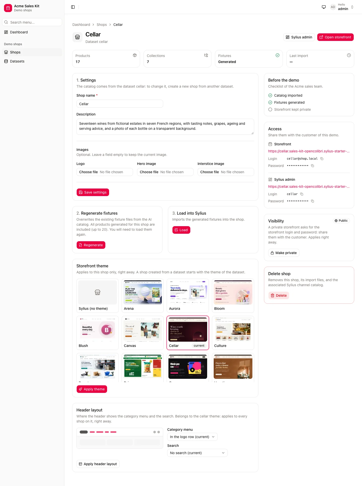
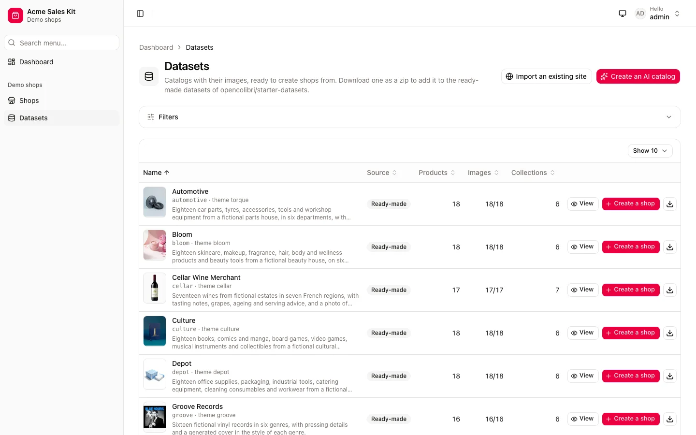
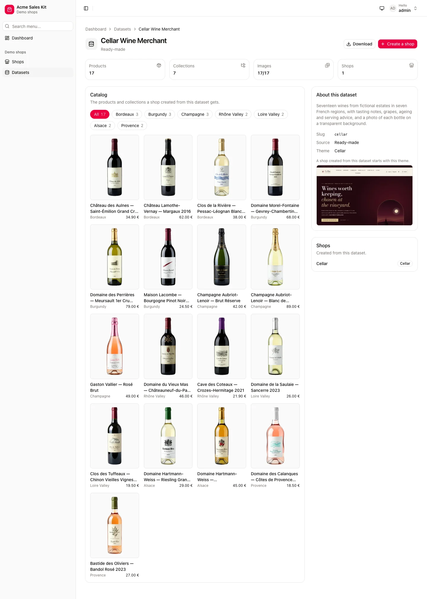

## Shops

The shop list shows each demo shop with its dataset, theme, products and fixtures, and filters them by dataset, theme,
fixtures or visibility. Each shop has its page:

- its settings (name, description, logo and images), then the steps to generate its fixtures and load them into Sylius;
- its **storefront theme**, picked from thumbnails, and the [header layout](../themes/header-layout.md) of that theme,
  with a preview of where the menu and the search go. The header layout belongs to the theme: it applies to every shop
  on it;
- the **access** to share with the customer: the storefront and its demo customer, and the Sylius admin of the shop,
  restricted to its channel;
- its **visibility**: a private shop only lets its demo customer into its storefront;
- its deletion.

## Datasets

The datasets are the ready-made ones of `opencolibri/starter-datasets` and the ones built from an AI description or an
existing website. Each one has a page with its catalog (products by collection, images, prices) and the shops created
from it, to check what a shop gets before creating it. A dataset can be downloaded as a zip, to add it to the
ready-made ones.

| Datasets | A dataset |
|---|---|
|  |  |

## Runs

Generating a catalog, loading fixtures or deleting a shop takes a while: the admin starts them through castor-api and
shows their progress, on the dashboard and on the page they concern. Two runs on the same shop or dataset do not
overlap: the admin says which one is still running.
