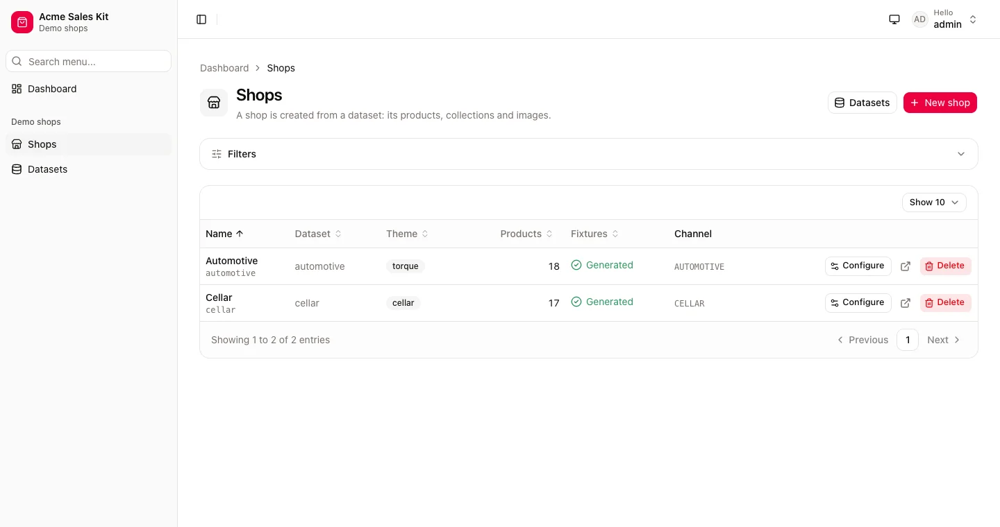

A sales kit runs many demo shops in one Sylius app, one channel and subdomain each, each one created
from a [dataset](../datasets/index.md): a ready-made one, or one [built with AI](../datasets/build.md) from a
description or an existing website. A sales team creates a shop for a prospect in a few clicks, gives it
the theme that suits them, and shares its storefront and its own Sylius admin.



## The pieces

```
sales kit admin ──HTTP──▶ castor-api ──▶ Castor tasks ──▶ shared Sylius app (one channel per shop)
(opencolibri/starter-sales-kit)          (opencolibri/starter-sales-kit-castor, …-dataset-builder, …-themes)
```

- **The stack** runs the shared Sylius app and [castor-api](https://github.com/jeromegxj/castor-api), which runs the
  Castor tasks over HTTP. It installs `opencolibri/starter-sales-kit-castor`, whose [`sylius:shop:*` tasks](shops.md)
  run the demo shops, and every theme next to each other. See [Setting up](setup.md).
- **The admin**, `opencolibri/starter-sales-kit`, is a Symfony bundle built on Sylius Shadcn Admin UI: each team builds
  its own instance from it (users, branding, colors, extra pages). It calls castor-api for every action and follows the
  long ones (catalog generation, fixtures load, deletion) as they run. See [The admin](admin.md).

The admin never changes Sylius itself: everything goes through the Castor tasks of the packages, which also work
without it, from the command line.
