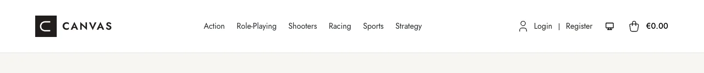
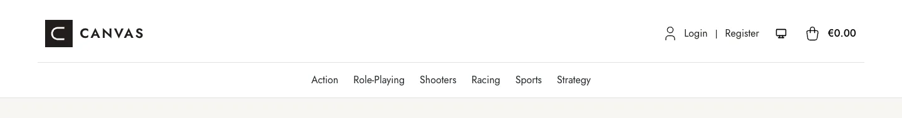
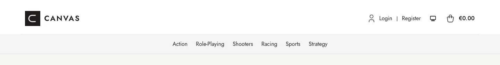
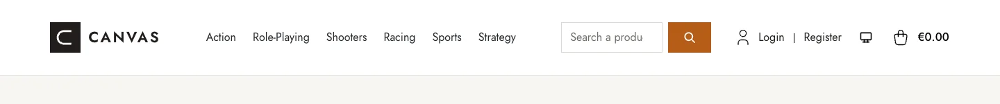
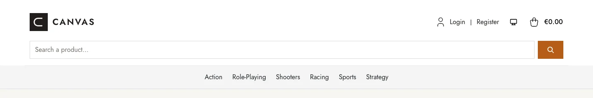
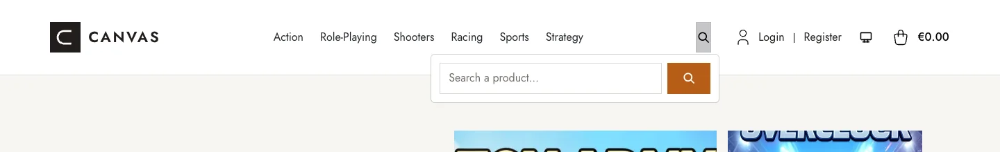
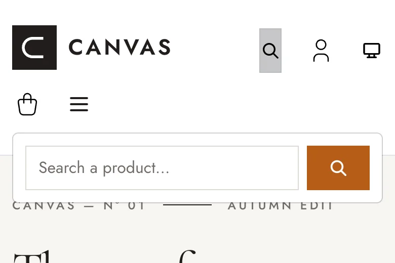
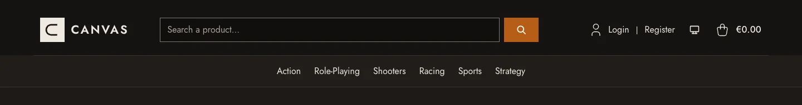
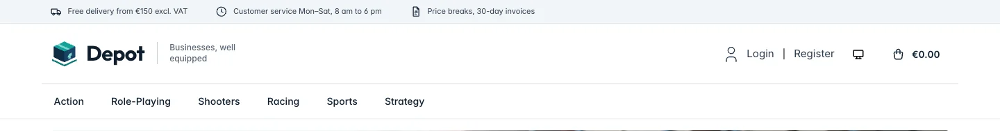
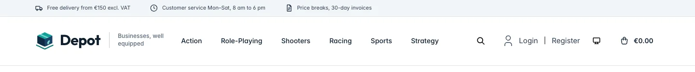

Every theme lets you choose where the header shows the category menu and the product search. Each theme comes
with the layout it was designed with, and you can change it when you install the theme or later.

| Option     | Values                                                                                                                                                 |
|------------|--------------------------------------------------------------------------------------------------------------------------------------------------------|
| `--menu`   | `inline`: in the logo row, between the logo and the account links<br>`below`: on a row of its own under the logo row, under a hairline<br>`bar`: in a full-width band under the logo row |
| `--search` | `none`: no search in the header<br>`inline`: in the logo row<br>`below`: on a row of its own under the logo row<br>`icon`: a magnifier in the logo row that opens the search in a dropdown |

On mobile, the menu always opens in an off-canvas panel and the search takes a row of its own under the logo (with
`icon`, the magnifier stays in the logo row and its dropdown spans the screen width).

| Theme                    | Menu     | Search   |
|--------------------------|----------|----------|
| Culture, Depot           | `below`  | `none`   |
| Torque                   | `below`  | `inline` |
| Drive                    | `bar`    | `inline` |
| Every other theme        | `inline` | `none`   |

Drive only supports the `bar` menu: its aisles bar has a title and a promotion link of its own.

## Examples

The header of the Canvas theme on desktop (1440 px), light scheme.

**Menu placement**

`--menu=inline` (Canvas default):



`--menu=below`:



`--menu=bar`:



**Search placement**

`--search=inline`:



`--menu=bar --search=below`:



`--search=icon`, dropdown open:



| `--search=icon` on mobile (390 px), dropdown open | `--menu=bar --search=inline`, dark scheme |
|---|---|
|  |  |

**Themes with their own search or layout**

Drive with `--search=icon`: its search by aisle, in the dropdown.


Depot with its default layout (`--menu=below`), then with `--menu=inline --search=icon`:





## Choose the layout

```bash
castor sylius:theme:setup canvas --menu=below --search=inline
```

To change the layout of the installed theme without reinstalling it (no asset build, only a cache clear):

```bash
castor sylius:theme:header                        # shows the current layout
castor sylius:theme:header --menu=bar --search=below
castor sylius:theme:header --search=none --theme=cellar   # a theme installed with --target=theme-bundle
```

With the [theme-bundle target](../commands/themes.md#one-theme-per-channel), each theme keeps its own layout, so
each channel gets the layout of its theme.

The `inline` search next to an `inline` menu suits short menus: with many categories, the menu links wrap on two
lines. Prefer `below` or `bar` for the menu then.

## How it works

The layout is shared by every theme (`src/Themes/header_layout/`, installed by `OpenColibri\Starter\Themes\HeaderLayout`,
like the [color schemes](color-schemes.md)):

- the options are Twig hook configuration, generated in `config/sylius/twig_hooks/shop/base/header_layout.php` (in
  `config/sylius/twig_hooks/themes/<theme>/` with the theme-bundle target, prefixed with the theme): do not edit it,
  use `castor sylius:theme:header`;
- the `themes_header_layout` hookable adds the `header-menu--<menu>` and `header-search--<search>` classes to the page
  wrapper (`sylius_shop.base#body_classes`);
- `_header-layout.scss`, imported at the root of each theme `app.scss`, lays the header row out from these classes,
  once for every theme. The menu column of each theme carries the `header-category-nav` class;
- the `themes_header_search` hookable (`sylius_shop.base.header.content`, priority 240, disabled with `none`) renders
  `shop/shared/layout/header_layout/search.html.twig`: a `header-search` column, or with `icon` a Bootstrap dropdown
  (like the color scheme switcher) whose field gets the focus when it opens. Both hold
  `search_form.html.twig`, a search on the whole catalogue through the product listing of the channel menu taxon,
  which includes its descendants.

A theme styles the menu and the search like the rest of its header, and only adds rules for a placement it wants to
look different (`.header-menu--below .<theme>-category-nav`…). To replace the search form, a theme ships
`templates/shop/shared/layout/header_layout/search_form.html.twig` (it gets an `id` for the field), which then works
in every placement: Torque reuses the search form of its hero, Drive its search by aisle.
